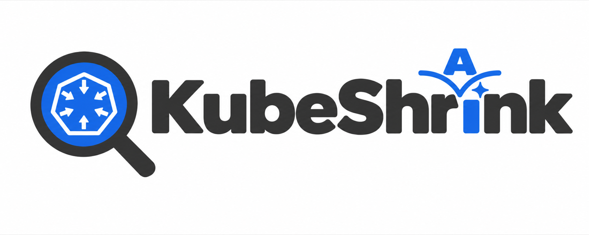

<p align="center">
  
</p>

# KubeShrink

**Find out why your cluster won't shrink, and why your teams' bin-packing is low.**

Your pods request a third of what your nodes offer, yet the nodes stay. KubeShrink reads your Kubernetes objects, read-only, and explains what keeps each node, which team holds how much idle capacity, and which settings keep the pods around. Every finding cites its evidence, states competing explanations and lists what it could not see.

> Status: early proof of concept (v0.1, unreleased). Expect breaking changes.
>
> Deterministic rules only: no model calls, and no data leaves your machine. The AI layer is on hold until the proof of concept shows the rules are worth building on; see [the roadmap](docs/DESIGN.md#9-roadmap).

## How it reads a cluster

**Levels** are what you ask about. **Layers** are where a cause sits.

| Level | Command | Question |
|---|---|---|
| Cluster | `explain cluster` | How many nodes would the requests fit on, how many run, and what keeps the rest? |
| Team | `explain team <namespace>` | How much idle capacity does this namespace hold, and why? |
| Node | `explain node <name>`, `explain nodes` | Why can't this node be removed? |

| Layer | Question it answers | What KubeShrink checks |
|---|---|---|
| replicas | Why do these pods exist? | HPA `minReplicas`, KEDA `minReplicaCount` and paused scaling, a ScaledObject fighting a second HPA, kube-downscaler settings |
| policy | Where may they run, and may they move? | Node selectors, required node and pod (anti-)affinity, taints, topology spread, host ports, PDBs with no room, `do-not-disrupt` and `safe-to-evict` annotations, bare pods, local storage |
| nodes | Will the node autoscaler remove or replace the node? | Karpenter NodePool `consolidationPolicy`, `consolidateAfter` and disruption budgets, NodeClaim state and events; Cluster Autoscaler annotations and thresholds |

Packing is measured with resource requests. A namespace's **idle share** is its part of the unrequested capacity on each node it uses, split between the namespaces on that node in proportion to their requests. Its **packing** is its requests divided by requests plus idle share.

## Quick start

Requires Go 1.26+.

```sh
make build
./bin/kubeshrink explain cluster -f examples/team-bin-packing
./bin/kubeshrink explain team checkout -f examples/team-bin-packing
./bin/kubeshrink explain node general-a -f examples/team-bin-packing
./bin/kubeshrink rules            # every rule, by layer, in plain language
```

An excerpt of `explain cluster` on the synthetic example:

```text
4 node(s) run; by requests alone their pods would fit on 2. Pods request 31% of allocatable CPU
and 19% of memory. Verdicts: 4 blocked, 0 possibly blocked, 0 with no blocker found.

What keeps nodes (rules that block or may block removal, most nodes first)
  no-room-elsewhere [policy, blocker] on 4 node(s): general-a, general-b, general-c, ml-a
      The other nodes say no because of: pod anti-affinity on 2 node(s), taint on 1 node(s).
  karpenter-consolidation-policy [nodes, blocker] on 1 node(s): ml-a
      NodePool ml only consolidates empty nodes (consolidationPolicy WhenEmpty). ...

Why pods exist: workloads held at a floor
  1 workload(s) at HPA minReplicas 3: 3 pod(s) requesting 1.5 CPU, 3.0Gi
  1 workload(s) at KEDA minReplicaCount 2: 2 pod(s) requesting 2.0 CPU, 4.0Gi

Namespaces by the idle capacity they hold
  NAMESPACE   PODS  NODES  REQUESTED        IDLE SHARE       PACKING CPU/MEM  PINNED
  ml          1     1      2.0 CPU, 8.0Gi   5.6 CPU, 23.5Gi  26% / 25%        0
  checkout    3     3      1.5 CPU, 3.0Gi   3.4 CPU, 21.5Gi  31% / 12%        1
```

`explain team checkout` then shows the three findings behind that team's number: its HPA floor of 3, the required anti-affinity that gives each replica its own node, and the placement check that finds no other node for any of them. Add `-o json` for machine-readable output.

### Your own data, offline

Export with kubectl and point KubeShrink at the file or directory:

```sh
mkdir -p .kubeshrink   # git-ignored
kubectl get nodes,pods,pdb,hpa,deploy,sts,rs,events -A -o yaml > .kubeshrink/cluster.yaml
kubeshrink explain cluster -f .kubeshrink/cluster.yaml
```

Add `scaledobjects.keda.sh`, `vpa`, `nodepools.karpenter.sh` and `nodeclaims.karpenter.sh` to the list if you use them.

### Live, read-only

```sh
kubeshrink explain cluster --context my-dev-cluster
kubeshrink explain team <namespace> --context my-dev-cluster -o json
kubeshrink snapshot --context my-dev-cluster --out .kubeshrink/dev   # save for offline replay
```

- `--context` is required; the current context is never used implicitly.
- Nodes with a `karpenter.sh/nodepool` label are treated as Karpenter-managed. Others are treated as Cluster Autoscaler-managed when its pods or events are visible; otherwise findings for both are kept, because managed offerings run Cluster Autoscaler outside the cluster. Override with `--node-autoscaler cluster-autoscaler|none`.
- KubeShrink only issues `list` calls, on a fixed set of resources, and never reads Secrets or ConfigMaps.
- For API-server-enforced read-only access, bind a dedicated identity to [docs/rbac.yaml](docs/rbac.yaml) (get/list only).

### As a kubectl plugin

```sh
make plugin && cp bin/kubectl-shrink /usr/local/bin/
kubectl shrink explain nodes --context my-dev-cluster
```

## Limitations

KubeShrink approximates; it is not a scheduler simulation. The placement check covers node selectors, required node affinity, taints, required pod (anti-)affinity, topology spread and host ports, but not volume zones, priorities or preemption. Cluster Autoscaler flags and node group minimums are not visible to it, packing uses requests rather than real usage, and a snapshot is one moment in time. Each report lists these limitations and each finding lists its unknowns. See [docs/DESIGN.md](docs/DESIGN.md).

## Design and roadmap

[docs/DESIGN.md](docs/DESIGN.md) covers the problem, prior art (and where KubeShrink genuinely differs), the evidence model, the code flow, every rule, and the roadmap, including the AI layer, which only ever works from verified findings.

## Contributing

See [CONTRIBUTING.md](CONTRIBUTING.md) and our [Code of Conduct](CODE_OF_CONDUCT.md). Report security issues as described in [SECURITY.md](SECURITY.md).

## License

Apache License 2.0. See [LICENSE](LICENSE).
