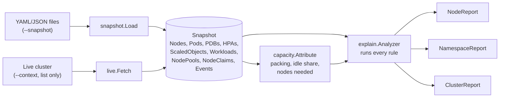

# KubeShrink design

Status: early proof of concept (v0.1, unreleased). **Deterministic rules only; no AI.** The AI layer is on hold until the proof of concept shows the rules are worth building on (section 9). This document explains what KubeShrink is for, how the code is organized, what each rule does, and where it is going.

## 1. The problem

A team lowers replicas for the weekend (say from 3 to 1), but the bill and the node-hours stay flat. The answer is usually spread across several controllers that each act correctly on their own:

- **Replicas**: HPA `minReplicas`, KEDA `minReplicaCount` or `paused-replicas`, scheduled downscalers such as kube-downscaler.
- **Policy**: where pods may run and whether they may move: node selectors, affinity, taints, topology spread, PDBs, annotations, bare pods, local storage.
- **Nodes**: Cluster Autoscaler or Karpenter decide whether a node can go away, within their own settings (Karpenter consolidation policy, `consolidateAfter`, disruption budgets; CA flags and thresholds).

The same question shows up per team as low bin-packing: a namespace requests little but its pods sit on nodes that stay mostly empty, so on paper the team holds far more capacity than it asks for.

Each tool reports its own piece (if at all). Nobody joins them into one answer: *"this node is still here because pod X has nowhere else to go, and pod Y exists only because two autoscalers both insist on 2 replicas."*

## 2. What KubeShrink does

KubeShrink reads Kubernetes objects, read-only, and explains in plain language why capacity did not go down. Every statement is a **finding**:

| Field | Meaning |
|---|---|
| `claim` | One sentence a human can act on. |
| `evidence` | The objects and fields that support it (`PodDisruptionBudget/data/db-pdb .status.disruptionsAllowed = 0`), with timestamps when they come from events. |
| `severity` | `blocker`, `possible-blocker` (depends on config we cannot see), `warning` (wasteful but not blocking), `context` (why the pods exist). |
| `confidence` | `high` for direct field reads, `medium` for heuristics, `low` when data is missing. |
| `appliesTo` | Cluster Autoscaler, Karpenter, or both. |
| `alternatives` | Competing explanations the reader should consider. |
| `unknowns` | What the snapshot cannot tell us that could change the conclusion. |

Each finding also has a `layer` (below), a stable `id` within its report (`F1`, `F2`, ...) and, where useful, a plain-language `meaning`.

A node's **verdict** is `blocked` if any blocker exists, `possibly-blocked` if only possible blockers exist, and `no-blocker-found` otherwise. `no-blocker-found` is deliberately not called "removable": absence of evidence is not proof.

### Levels and layers

Levels are what a user asks about; layers are where a cause sits. Every report groups its findings by layer, in this order.

| Level | Command | Question |
|---|---|---|
| Cluster | `explain cluster` | How many nodes would the requests fit on, how many run, and which rules keep the rest? |
| Team | `explain team <namespace>` (alias `namespace`, `ns`) | How much idle capacity does this namespace hold, and why? |
| Node | `explain node <name>`, `explain nodes` | Why can't this node be removed? |

| Layer | Question |
|---|---|
| `replicas` | Why do these pods exist? |
| `policy` | Where may they run, and may they move? |
| `nodes` | Will the node autoscaler remove or replace the node? |

### Packing, idle share and nodes needed

All capacity numbers use resource requests, never real usage.

- **Node packing** is requested divided by allocatable, per resource.
- **Idle share**: each node's unrequested capacity (allocatable minus all requests) is split between the namespaces with pods on it, in proportion to their requests, separately for CPU and memory. A namespace that requests 0.5 of the 1.6 CPU requested on a 4 CPU node holds 0.5 / 1.6 x 2.4 = 0.75 CPU of idle capacity there. Idle capacity on a node where nothing requests that resource is reported as unattributed.
- **Team packing** is the namespace's requests divided by requests plus idle share.
- **Nodes needed** is, per pool, how many of the pool's nodes would hold its pods if they were packed by requests alone (largest pods first, onto the largest nodes, keeping each node's DaemonSet and static pods). Placement rules are ignored, so it is a lower bound, not a plan; the gap between it and the nodes running is what the rules then explain.

Pools are read from the first of these node labels that is set: `karpenter.sh/nodepool`, `cloud.google.com/gke-nodepool`, `eks.amazonaws.com/nodegroup`, `agentpool`, `kops.k8s.io/instancegroup`.

## 3. Non-goals

- **No writes, ever.** No scaling, evicting, annotating or patching. KubeShrink explains; humans decide.
- **Not a scheduler or autoscaler simulator.** It approximates the important checks and says so.
- **Not a cost tool.** It does not price nodes (OpenCost does). It explains why nodes exist.
- **Not a general troubleshooter.** Crash loops and OOMs belong to other tools.
- **No Secrets or ConfigMap data**, in any mode.

## 4. Prior art and where KubeShrink differs

| Tool | What it does | Overlap with KubeShrink |
|---|---|---|
| [KubeWhy](https://github.com/didiberman/kubewhy) | Read-only, LLM-driven investigator for "why is my pod broken" questions; shows the kubectl commands it used. | Shares the read-only and show-your-work ideas. Focuses on pod failures, answers are model-generated, and it does not reason about scale-down. |
| Cluster Autoscaler | Its status ConfigMap, logs and events (and GKE's visibility logs) give `noScaleDown` reasons per node. | **Strong overlap for the node layer** when you run CA and can read its logs. |
| Karpenter | `DisruptionBlocked` / `Unconsolidatable` events name PDBs, do-not-disrupt annotations and budgets. | **Strong overlap for the node layer** on Karpenter clusters. KubeShrink quotes these events as evidence. |
| kube-capacity | Requests, limits and usage per node. | Raw numbers only, no "why". |
| Kor | Finds unused objects (ConfigMaps, Secrets, PVCs...). | Different question (object waste, not capacity). |
| OpenCost | Allocates cost, including idle cost, and can share idle cost across namespaces. | Says *how much* is idle and who pays for it, not *why* it stays. KubeShrink's idle share is the same idea in requests, joined with the reasons. |
| Goldilocks | VPA-based request recommendations. | Right-sizing; complementary. |

**Honest assessment.** "Why can't this node be removed?" on its own is already partly answered by the autoscalers themselves. If KubeShrink stopped there it would be a thin wrapper. The differentiation that holds up:

1. **Cross-layer explanation**: joining replica-layer causes (HPA/KEDA floors, paused KEDA scaling, two HPAs on one workload, downscaler targets below an HPA floor) with node-layer blockers in one report. No tool above does this.
2. **One evidence model for both autoscalers**, including the cases each autoscaler reports poorly (e.g. a pod covered by two PDBs).
3. **Reproducible offline snapshots** for post-mortems and sharing, plus the same rules on a live cluster.
4. **Explicit competing explanations and unknowns**, rather than a single verdict.

The value hypothesis still has to be proven by the time-window work ("replicas fell Friday 18:00, node-hours did not"), which the MVP only prepares for.

## 5. How the code is organized

| Path | Role |
|---|---|
| `cmd/kubeshrink` | CLI: parses flags, picks the source, prints the report. Also usable as `kubectl shrink`. |
| `internal/snapshot` | Minimal object types (only the fields rules read), label, node and pod-affinity matching, pod requests (init containers, native sidecars, overhead), the file loader (multi-document YAML, kubectl `List`s, JSON), lookups. |
| `internal/capacity` | Request-based capacity math: node packing, idle share per namespace, pools and nodes needed. |
| `internal/live` | The live reader: a fixed list of resources, `list` calls only through the dynamic client (Karpenter kinds at `v1`, falling back to `v1beta1`), the snapshot time and Kubernetes version, and optional export for offline replay. |
| `internal/explain` | The rule engine: `Catalog` (every rule with its layer and a plain-language explanation), the rules, the placement simulation, Karpenter checks, node, team and cluster reports, rendering. |
| `examples/team-bin-packing` | A synthetic four-team Karpenter cluster used by the README and the tests. |
| `examples/weekend-scale-down` | A synthetic weekend scenario used by the tests. |

**Code flow for `kubeshrink explain team checkout`:**

1. `main.run` loads a `Snapshot` from files or from the live reader. Both produce the same structure, so rules never know where data came from.
2. `explain.NewAnalyzer` computes the capacity attribution once and caches node reports, so the cluster and team views explain each node only once.
3. The team view runs the namespace rules (replica floors and spread constraints of the team's own workloads), then explains every node the team uses.
4. For each node, pods are sorted into *ignored* (DaemonSet, static, finished) and *pods that must move*, and every node rule in `Catalog` runs against them. Then the node's autoscaler is decided (section 6) and findings that only matter to another autoscaler are dropped, with a note.
5. The team report keeps the node findings about its own pods and about cluster-scoped objects such as the node, counts the findings about other teams' pods, removes duplicates, groups by layer and numbers the findings.

Adding a rule means writing one `func(*nodeContext) []Finding` or `func(*nsContext) []Finding`, adding it to `Catalog` with its layer and explanation, and adding a test case.

### The placement check

`no-room-elsewhere` simulates draining one node. Every other node keeps its pods; cordoned nodes take no new pods but still count for affinity and spread. The drained node's pods are placed largest first, each on the first node that passes, in this order: node selector, required node affinity, taints, free CPU, memory and pod slots, host ports, required pod anti-affinity (the pod's own terms and those of pods already there), required pod affinity (a pod that matches its own term may start a group anywhere) and enforced topology spread (skew over the nodes that pass the pod's node selection, with `minDomains`). A placed pod reserves its requests and counts for later pods. A pod that fits nowhere keeps the node; the finding cites each node's first reason and sums them up ("pod anti-affinity on 2 node(s), taint on 1 node(s)"). First-fit can miss a packing that exists, so confidence is medium.

## 6. The rules, in plain language

Run `kubeshrink rules` (or `rules -o json`) for the authoritative list.

| Layer | Rule | Plain-language meaning | Severity |
|---|---|---|---|
| replicas | `replica-floor` | The workload sits at its HPA or KEDA minimum: the pods exist because of configuration, not load. Says what they request. | context |
| replicas | `keda-paused` | KEDA scaling is paused at a fixed count. | context |
| replicas | `keda-hpa-conflict` | A KEDA ScaledObject and a separate HPA both drive one workload. | warning |
| replicas | `downscaler-excluded` | The workload opted out of scheduled downscaling. | context |
| replicas | `downscaler-vs-hpa-floor` | kube-downscaler sets fewer replicas than the HPA allows, so the HPA scales back up. | warning |
| policy | `spread-constraint` | Required anti-affinity or an enforced topology spread keeps a team's replicas apart (team view). | context |
| policy | `no-room-elsewhere` | The placement check finds no other node for a pod. | blocker |
| policy | `pdb-zero-disruptions` | The pod's disruption budget has no room, so eviction is refused; structural or transient. | blocker |
| policy | `multiple-pdbs` | Two budgets select the same pod; eviction is always refused. | blocker |
| policy | `karpenter-do-not-disrupt` | A pod says "Karpenter, don't touch my node" (on the node itself, the finding is in the nodes layer). | blocker (Karpenter) |
| policy | `ca-safe-to-evict-false` | A pod told Cluster Autoscaler it must not be evicted. | blocker (CA) |
| policy | `pod-without-controller` | Nothing would recreate this pod elsewhere. | blocker (CA) |
| policy | `local-storage` | emptyDir/hostPath may block CA, depending on a flag we cannot see. | possible blocker (CA) |
| policy | `kube-system-pod` | A system pod without a PDB may block CA, depending on a flag. | possible blocker (CA) |
| nodes | `ca-scale-down-disabled` | The node opted out of Cluster Autoscaler scale-down. | blocker (CA) |
| nodes | `utilization-above-threshold` | The node is too busy for CA to consider it (default 50%). | possible blocker (CA) |
| nodes | `karpenter-consolidation-policy` | The NodePool only consolidates empty nodes, and this one has pods to move. | blocker (Karpenter) |
| nodes | `karpenter-consolidation-disabled` | The NodePool sets `consolidateAfter: Never`. | blocker (Karpenter) |
| nodes | `karpenter-budget` | A disruption budget of 0 nodes, always or in a scheduled window. | blocker or possible blocker (Karpenter) |
| nodes | `karpenter-not-consolidatable-yet` | The NodeClaim is not consolidatable yet: `consolidateAfter` has not passed since pods last changed. | context (Karpenter) |
| nodes | `autoscaler-event` | Quotes what Cluster Autoscaler or Karpenter reported about the node, its NodeClaim or its pods, with a plain-language reading. When the autoscaler says it keeps the node (`Unconsolidatable`, `DisruptionBlocked`, `ScaleDownFailed`), it is a possible blocker. | context or possible blocker |

### Which autoscaler manages a node

- A node with a `karpenter.sh/nodepool` label (or the older `karpenter.sh/provisioner-name`) is Karpenter-managed: Cluster Autoscaler-only findings are dropped for it.
- Otherwise, if Cluster Autoscaler's pods, workload or events are in the snapshot, the node is CA-managed: Karpenter-only findings are dropped.
- Otherwise the manager is `unknown` and findings for both are kept, with a note. Managed offerings run Cluster Autoscaler outside the cluster, so not seeing it proves nothing.
- `--node-autoscaler cluster-autoscaler` or `none` overrides the last two cases. With `none`, autoscaler-specific findings are dropped and the report says that nothing removes nodes automatically.

## 7. Limitations (printed with every report)

- A snapshot heuristic, not a scheduler simulation: placement checks cover node selectors, required node affinity, taints, required pod (anti-)affinity, topology spread and host ports, but not volume zones, priorities, preemption or preferred rules.
- Autoscaler settings are read where the cluster exposes them (Karpenter NodePools and NodeClaims), not Cluster Autoscaler flags or node group minimums.
- One point in time: PDB status, replica counts and events change.
- Packing is measured with resource requests, not real usage.
- Read-only: KubeShrink never modifies a cluster.

## 8. Safety model

- Live mode requires `--context` (the current context is never used implicitly) and prints a read-only notice.
- It issues `list` calls only, on a fixed set of resources (`internal/live/live.go`), never Secrets or ConfigMaps. A unit test asserts this.
- For enforcement by the API server rather than by our code, bind a dedicated identity to [`docs/rbac.yaml`](rbac.yaml) (get/list only).
- Exports (`kubeshrink snapshot --out`) are written with owner-only permissions. Keep them in `.kubeshrink/`, which is git-ignored; real cluster data never belongs in the repository.

## 9. Roadmap

**Proof of concept (this slice):** `explain cluster`, `explain team`, `explain node(s)`; 21 rules in three layers; a placement check with affinity, topology spread and host ports; Karpenter NodePools, NodeClaims and their events; autoscaler detection; offline snapshots and live read-only mode; text and JSON output.

**Next, in order:**
1. **Requests layer**: how big each pod is, from the VPA recommendations KubeShrink already reads: requests above the upper bound, recommendations that are not applied, VPA and HPA acting on the same resource, `minAllowed` floors, and a second nodes-needed estimate at VPA targets.
2. **In-cluster proof of concept**: `kubeshrink serve` with a low-cardinality Prometheus `/metrics` endpoint and JSON logs, and a Helm chart with a read-only ClusterRole. No CRDs: findings are recomputed from the cluster on every scan, so there is no state to store.
3. `explain workload <name>`: why didn't this workload's replicas drop?
4. **Time windows**: compare two snapshots (or a metrics source) to explain "replicas fell but node-hours didn't" over a weekend.
5. Packaging: release binaries and a Krew manifest.

### How AI fits in (on hold)

KubeShrink has no AI: every finding comes from a deterministic rule. AI work is on hold until the proof of concept shows the rules are useful. When it resumes, it builds on the rules: rules gather and verify facts, AI interprets them and decides what to check next, and rules confirm or rule out what AI proposes. AI never invents facts. The tool must work fully with AI turned off.

1. **Explain**: turn findings into a plain-language narrative in which every sentence links to finding or evidence IDs; a checker rejects any sentence without evidence.
2. **Investigate**: an agent loop that decides what to check next (other time windows, related objects), using only KubeShrink's read-only queries as its tools.
3. **Weigh explanations**: the model proposes candidate causes; deterministic checks confirm or rule out each one.
4. **Integrate**: an MCP server that exposes read-only findings so AI assistants can query verified facts.

Principles: pluggable model (hosted or local); no cluster data leaves the machine unless the user explicitly configures a hosted model.

## 10. Open decisions

- Final module path / repository visibility once the project is ready to be public.
- Whether the live reader should also offer a typed (client-go informer) mode for very large clusters.
- How to represent time windows: two snapshots, or a metrics backend (Prometheus) as an optional source.
- When neither autoscaler is visible, findings for both are kept (managed Cluster Autoscaler runs outside the cluster); `--node-autoscaler none` drops them. Revisit if this proves noisy.
- Nodes needed ignores placement rules, so it is a lower bound. A placement-aware estimate would need a full packing simulation.
- Idle share is split by requests. Splitting by real usage needs a metrics source.
