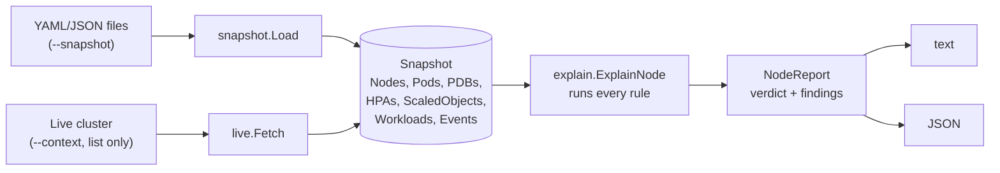

# KubeShrink design

Status: early prototype (v0.1, unreleased). **The current version uses deterministic rules only; it contains no AI yet.** AI is a core part of the planned loop and the next layer to build (section 9). This document explains what KubeShrink is for, how the code is organized, what each rule does, and where it is going.

## 1. The problem

A team lowers replicas for the weekend (say from 3 to 1), but the bill and the node-hours stay flat. The answer is usually spread across several controllers that each act correctly on their own:

- **Replica layer**: HPA `minReplicas`, KEDA `minReplicaCount` or `paused-replicas`, scheduled downscalers such as kube-downscaler, VPA changing requests.
- **Node layer**: Cluster Autoscaler or Karpenter decide whether a node can go away, and are stopped by PDBs, annotations, bare pods, local storage, scheduling constraints and utilization thresholds.

Each tool reports its own piece (if at all). Nobody joins them into one answer: *"this node is still here because pod X has nowhere else to go, and pod Y exists only because two autoscalers both insist on 2 replicas."*

## 2. What KubeShrink does

KubeShrink reads Kubernetes objects, read-only, and explains in plain language why capacity did not go down. Every statement is a **finding**:

| Field | Meaning |
|---|---|
| `claim` | One sentence a human can act on. |
| `evidence` | The objects and fields that support it (`PodDisruptionBudget/data/db-pdb .status.disruptionsAllowed = 0`), with timestamps when they come from events. |
| `severity` | `blocker`, `possible-blocker` (depends on config we cannot see), `warning` (wasteful but not blocking), `context` (why the pods exist). |
| `confidence` | `high` for direct field reads, `medium` for heuristics, `low` when data is missing. |
| `appliesTo` | Cluster Autoscaler, Karpenter, or both. |
| `alternatives` | Competing explanations the reader should consider. |
| `unknowns` | What the snapshot cannot tell us that could change the conclusion. |

A node's **verdict** is `blocked` if any blocker exists, `possibly-blocked` if only possible blockers exist, and `no-blocker-found` otherwise. `no-blocker-found` is deliberately not called "removable": absence of evidence is not proof.

## 3. Non-goals

- **No writes, ever.** No scaling, evicting, annotating or patching. KubeShrink explains; humans decide.
- **Not a scheduler or autoscaler simulator.** It approximates the important checks and says so.
- **Not a cost tool.** It does not price nodes (OpenCost does). It explains why nodes exist.
- **Not a general troubleshooter.** Crash loops and OOMs belong to other tools.
- **No Secrets or ConfigMap data**, in any mode.

## 4. Prior art and where KubeShrink differs

| Tool | What it does | Overlap with KubeShrink |
|---|---|---|
| [KubeWhy](https://github.com/didiberman/kubewhy) | Read-only, LLM-driven investigator for "why is my pod broken" questions; shows the kubectl commands it used. | Shares the read-only and show-your-work ideas. Focuses on pod failures, answers are model-generated, and it does not reason about scale-down. |
| Cluster Autoscaler | Its status ConfigMap, logs and events (and GKE's visibility logs) give `noScaleDown` reasons per node. | **Strong overlap for the node layer** when you run CA and can read its logs. |
| Karpenter | `DisruptionBlocked` / `Unconsolidatable` events name PDBs, do-not-disrupt annotations and budgets. | **Strong overlap for the node layer** on Karpenter clusters. KubeShrink quotes these events as evidence. |
| kube-capacity | Requests, limits and usage per node. | Raw numbers only, no "why". |
| Kor | Finds unused objects (ConfigMaps, Secrets, PVCs...). | Different question (object waste, not capacity). |
| OpenCost | Allocates cost, including idle cost. | Says *how much* is idle, not *why* it stays. |
| Goldilocks | VPA-based request recommendations. | Right-sizing; complementary. |

**Honest assessment.** "Why can't this node be removed?" on its own is already partly answered by the autoscalers themselves. If KubeShrink stopped there it would be a thin wrapper. The differentiation that holds up:

1. **Cross-layer explanation**: joining replica-layer causes (HPA/KEDA floors, paused KEDA scaling, two HPAs on one workload, downscaler targets below an HPA floor) with node-layer blockers in one report. No tool above does this.
2. **One evidence model for both autoscalers**, including the cases each autoscaler reports poorly (e.g. a pod covered by two PDBs).
3. **Reproducible offline snapshots** for post-mortems and sharing, plus the same rules on a live cluster.
4. **Explicit competing explanations and unknowns**, rather than a single verdict.

The value hypothesis still has to be proven by the time-window work ("replicas fell Friday 18:00, node-hours did not"), which the MVP only prepares for.

## 5. How the code is organized

| Path | Role |
|---|---|
| `cmd/kubeshrink` | CLI: parses flags, picks the source, prints the report. Also usable as `kubectl shrink`. |
| `internal/snapshot` | Minimal object types (only the fields rules read), the file loader (multi-document YAML, kubectl `List`s, JSON), quantity parsing, lookups. |
| `internal/live` | The live reader: a fixed list of resources, `list` calls only through the dynamic client, optional export to a local directory so a live run can be replayed offline. |
| `internal/explain` | The rule engine: `Catalog` (every rule with a plain-language explanation), the rules, the first-fit placement heuristic, report rendering. |
| `examples/weekend-scale-down` | A synthetic scenario used by the README and the tests. |

**Code flow for `kubeshrink explain node node-c`:**

1. `main.run` parses flags and loads a `Snapshot` from files or from the live reader. Both produce the same structure, so rules never know where data came from.
2. `explain.ExplainNode` sorts the node's pods into *ignored* (DaemonSet, static, finished) and *pods that must move*.
3. It runs every rule in `Catalog` against a `nodeContext` (snapshot, node, pods that must move). Each rule returns zero or more findings.
4. If the node is labelled `karpenter.sh/nodepool`, findings that only apply to Cluster Autoscaler are dropped and a data note says how many.
5. Findings are sorted (blockers first), counted into a verdict and summary, and rendered.

Adding a rule means writing one `func(*nodeContext) []Finding`, adding it to `Catalog` with an explanation, and adding a table test case.

## 6. The rules, in plain language

Run `kubeshrink rules` for the authoritative list. Today:

| Rule | Plain-language meaning | Severity |
|---|---|---|
| `karpenter-do-not-disrupt` | A pod or the node says "Karpenter, don't touch me". | blocker (Karpenter) |
| `ca-scale-down-disabled` | The node opted out of Cluster Autoscaler scale-down. | blocker (CA) |
| `ca-safe-to-evict-false` | A pod told Cluster Autoscaler it must not be evicted. | blocker (CA) |
| `pdb-zero-disruptions` | The pod's disruption budget has no room, so eviction is refused. Says whether that is structural (budget equals replicas) or transient (pods unhealthy). | blocker |
| `multiple-pdbs` | Two budgets select the same pod; eviction is always refused. | blocker |
| `pod-without-controller` | Nothing would recreate this pod elsewhere. | blocker (CA) |
| `local-storage` | emptyDir/hostPath may block CA, depending on a flag we cannot see. | possible blocker |
| `kube-system-pod` | A system pod without a PDB may block CA, depending on a flag. | possible blocker |
| `utilization-above-threshold` | The node is too busy for CA to even consider it (default 50%). | possible blocker |
| `no-room-elsewhere` | Placing each pod on the other nodes by nodeSelector, taints and requests fails. First-fit, so medium confidence. | blocker |
| `replica-floor` | The workload is at its HPA or KEDA minimum: the pods exist because of configuration, not load. | context |
| `keda-paused` | KEDA scaling is paused at a fixed count. | context |
| `keda-hpa-conflict` | A KEDA ScaledObject and a separate HPA both drive one workload. | warning |
| `downscaler-excluded` | The workload opted out of scheduled downscaling. | context |
| `downscaler-vs-hpa-floor` | kube-downscaler sets fewer replicas than the HPA allows, so the HPA scales back up. | warning |
| `autoscaler-event` | Quotes what Cluster Autoscaler or Karpenter itself reported about the node or its pods. | context |

## 7. Limitations (printed with every report)

- A snapshot heuristic, not a scheduler simulation: affinity, topology spread, host ports, volume zones, priorities and preemption are not evaluated.
- Autoscaler configuration (CA flags, Karpenter NodePool budgets, node group minimums) is not read; it only appears through events.
- One point in time. PDB status, replica counts and events change.
- Fit uses requests, not real usage. Init containers and pod overhead are not counted yet.

## 8. Safety model

- Live mode requires `--context` (the current context is never used implicitly) and prints a read-only notice.
- It issues `list` calls only, on a fixed set of resources (`internal/live/live.go`), never Secrets or ConfigMaps. A unit test asserts this.
- For enforcement by the API server rather than by our code, bind a dedicated identity to [`docs/rbac.yaml`](rbac.yaml) (get/list only).
- Exports (`kubeshrink snapshot --out`) are written with owner-only permissions. Keep them in `.kubeshrink/`, which is git-ignored; real cluster data never belongs in the repository.

## 9. Roadmap

**MVP (this slice):** offline snapshots, live read-only mode, `explain node` / `explain nodes`, 16 rules, text and JSON output, kubectl plugin naming.

**Next:**
- Karpenter NodePools/NodeClaims (budgets, consolidation policy) and the CA status ConfigMap as first-class evidence, including NodeClaim events and a plain-language reading of `Unconsolidatable` reasons such as "can't replace with a cheaper node".
- Detect Cluster Autoscaler-managed nodes too, so Karpenter-only findings can be dropped symmetrically.
- Pod affinity, topology spread and init-container requests in the fit heuristic.
- `explain workload <name>`: why didn't this workload's replicas drop?
- **Time windows**: compare two snapshots (or a metrics source) to explain "replicas fell but node-hours didn't" over a weekend.
- Packaging: release binaries, Krew manifest; a Helm chart or in-cluster mode only if there is demand.

### How AI fits in (the next layer)

Today KubeShrink has no AI: every finding comes from a deterministic rule. AI is part of the intended loop and the next layer to build, on top of the rules: rules gather and verify facts, AI interprets them and decides what to check next, and rules confirm or rule out what AI proposes. AI never invents facts. The tool must work fully with AI turned off.

1. **Explain**: turn findings into a plain-language narrative in which every sentence links to finding or evidence IDs; a checker rejects any sentence without evidence.
2. **Investigate**: an agent loop that decides what to check next (other time windows, related objects), using only KubeShrink's read-only queries as its tools.
3. **Weigh explanations**: the model proposes candidate causes; deterministic checks confirm or rule out each one.
4. **Integrate**: an MCP server that exposes read-only findings so AI assistants can query verified facts.

Principles: pluggable model (hosted or local); no cluster data leaves the machine unless the user explicitly configures a hosted model.

## 10. Open decisions

- Final module path / repository visibility once the project is ready to be public.
- Whether the live reader should also offer a typed (client-go informer) mode for very large clusters.
- How to represent time windows: two snapshots, or a metrics backend (Prometheus) as an optional source.
